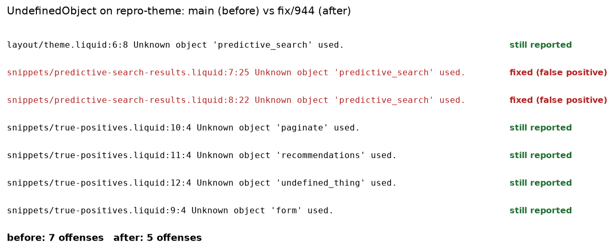

# #944: `Unknown object 'predictive_search'` in snippets that use ``

Repro theme, captures and the script that regenerates them for the fix on
`fix/944-predictive-search-in-doc-snippets`.

| File | What it is |
| --- | --- |
| `repro-theme/` | Minimal theme. `.theme-check.yml` enables only `UndefinedObject`. |
| `offenses.mjs` | Runs the built `theme-check-node` on a theme and prints one line per offense. |
| `capture.sh` | Builds main's sources, captures, rebuilds the branch, captures again, renders the PNG. |
| `theme-check-before.txt` / `theme-check-after.txt` | `offenses.mjs` output on main (ee5ab68) and on the branch. |
| `tests-before.txt` / `tests-after.txt` | The 3 touched spec files run against main's sources and against the branch. |
| `render_capture.py` | Renders the two theme-check captures into `before-after.png` (needs matplotlib). |

Regenerate: `PYTHON=/path/to/python-with-matplotlib docs/fixes/944-predictive-search-snippets/capture.sh`
from the repo root with a clean tree.

