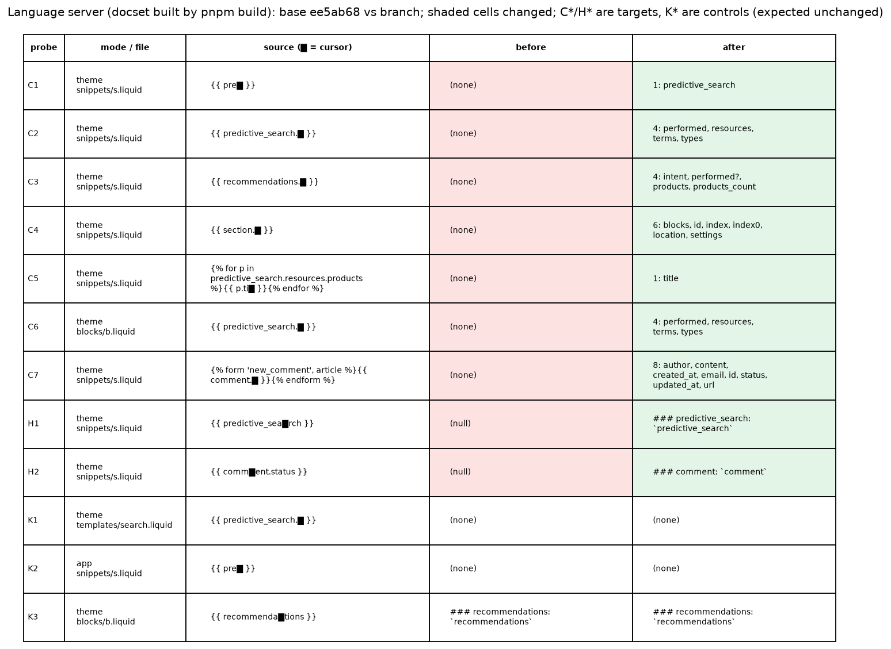

# Section objects in theme blocks and snippets (upstream issue 944)

Repro theme, captures and the scripts that regenerate them, for
`fix/944-predictive-search-in-doc-snippets` (fork only; this directory is not
part of the upstream-ready branch).

| File | What it is |
| --- | --- |
| `repro-theme/` | Minimal theme. `.theme-check.yml` enables only `UndefinedObject`. |
| `offenses.mjs` | Runs the built `theme-check-node` on a theme, one line per offense, sorted by file, line, column. |
| `ls-capture.mjs` | Drives the built language server's `CompletionsProvider` / `HoverProvider` with the real Shopify docset on 10 probes (8 targets, 2 controls). |
| `capture.sh` | Refuses a dirty tree; checks out base `ee5ab68`'s check and `TypeSystem` sources (restored by a trap), builds, captures; rebuilds the branch, captures; renders the PNGs. |
| `theme-check-{before,after}.txt` | `offenses.mjs` on base and branch. |
| `ls-{before,after}.tsv` | `ls-capture.mjs` on base and branch. |
| `tests-{before,after}.txt` | The 3 touched spec files on base sources and on the branch. |
| `render_capture.py` | Renders `before-after.png` and `ls-before-after.png` (needs matplotlib). |

Regenerate from the repo root with a clean tree:
`PYTHON=/path/to/python-with-matplotlib docs/fixes/944-predictive-search-snippets/capture.sh`

